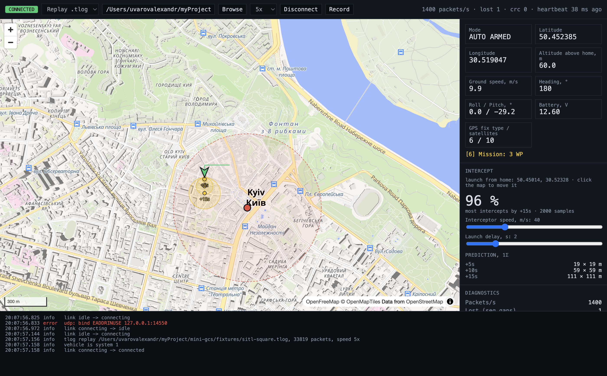

# Mini GCS

I pointed the app at a copter flying a mission in SITL. HUD said **STABILIZE**. Altitude said **60 m**. One of those numbers was lying.

It was the mode. ArduPilot routes the heartbeat of the ground station (MAVProxy, system 255) to every link, and my merge took the last heartbeat it saw. The vehicle was in AUTO the whole time. That bug is why the link now learns the vehicle id from the first non-GCS heartbeat and drops everyone else.

This repo is a small ground control station: Electron + React + TypeScript, MAVLink in, a map with a predicted track out. It talks to a real autopilot (ArduPilot SITL in Docker), records flights to `.tlog` and replays them, runs a hand-written Kalman filter to say where the drone will be in 5/10/15 seconds, and estimates whether an interceptor launched from home can get there first.



Everything on the screenshot is real data. ArduCopter 4.7 flew a looping square in SITL, I recorded it to `fixtures/sitl-square.tlog`, and the Playwright e2e test replayed it at 5x and took the picture.

## Run it

```sh
npm install
npm run sitl        # ArduPilot SITL in Docker; first run builds the image, 10-20 min, nothing installed on the host
npm run sitl:fly    # second terminal: uploads a looping mission, arms, takes off, switches to AUTO
npm run dev         # third terminal: the app, already listening on UDP 14550
```

No Docker? `npm run fake` streams a scripted circle. Or pick "Replay .tlog" in the app and open `fixtures/sitl-square.tlog`.

```sh
npm run typecheck && npm run lint && npm test   # 44 unit tests
npm run build && npm run e2e                     # Playwright drives the built app through a replay
npm run record -- --seconds 60                   # record your own .tlog from SITL
npm run dist:mac                                 # unsigned .dmg
```

Flight commands and the SITL port map: `tools/sitl/takeoff.md`. Other telemetry sources: `tools/sitl.md`.

## How it is built

Main process owns the bytes. Renderer owns the pixels. Nothing in between knows about MAVLink.

```
byteSources (udp | tcp | tlog) ─► splitter ─► parser ─► normalize ─► TelemetryFrame in SI units
                                                                         │ batched every 16 ms
                                                                         ▼
useTelemetryBatches  ─► useTrajectoryPrediction (ring-buffer track, Kalman CV, 5/10/15 s)
useGcsBridge         ─► merged snapshot per message slice, link status, log
useInterceptScenario ─► Monte Carlo in a Web Worker
```

- `src/shared/ipc.ts` is the only contract between processes. `units.ts` and `defaults.ts` hold the numbers everyone reuses.
- `src/main/link/` — transports behind one `{ start, stop, send? }` shape, per-window statistics, a pure `nextLinkState()` with hysteresis, reconnect with backoff, `.tlog` recorder.
- `src/renderer/src/prediction/` — local ENU frame, 4x4 matrix helpers, the filter, the trajectory and its ellipses.
- `src/renderer/src/hooks/` — `useGcsBridge` is called once in `App`; everything else gets props.
- `tools/` — fake vehicle, smoke receiver, tlog recorder, SITL Dockerfile and the flight script.

Three decisions I would defend:

1. **No worker thread for parsing.** Diagnostics panel measures split + parse + normalise at 5–6 µs per packet. 1400 packets/s during 5x replay is under 1 % of a core. A `worker_threads` hop would add serialisation for nothing.
2. **Replay keeps the recorded timestamps on frames.** The filter's dt is the original flight's. Anything that means "now" (heartbeat age, IPC latency) reads the wall clock from `TelemetryBatch.sentAtEpochMs` or from the link itself.
3. **Vehicle = first non-GCS heartbeat.** See the first paragraph.

## Rules I keep

- Names carry units and frames: `altitudeAboveHomeMeters`, `velocityNorthMetersPerSecond`, `receivedAtEpochMs`. No `alt`, `hdg`, `ts`, `cfg`. Booleans are `isX`.
- GeoJSON pairs are typed `LongitudeLatitude`, so the reversed order is in the type, not in my memory.
- MAVLink field names live only on `node-mavlink` objects. Our types speak SI.
- Arrow functions, no classes, factories with closure state. Declare first, one `export { ... }` at the bottom.
- Comments only for a why that is not in the code: a wire unit, a protocol quirk, a bug that cost time.
- Prettier and oxlint with the same config I use at work.

## Things that bit me

Each one cost real time. The fix matters more than the symptom.

1. Every link went DEGRADED after ~30 s at 5 % loss. Loss ratio was cumulative lost over a 1 s window of received. Count both in the same window.
2. `@vitejs/plugin-react` v6 wants Vite 8, electron-vite 5 stops at Vite 7. Pinned the plugin to 5.2.
3. `npm install` left Electron without its binary; electron-vite died with `Electron uninstall`. `node node_modules/electron/install.js`.
4. ArduPilot's prereq script dies in Docker on `usermod -a -G dialout $USER`. `USER` is unset in a container.
5. The SITL container exits silently when detached: MAVProxy quits on a closed stdin and takes SITL with it. Detached runs need `-d -t`.
6. SITL's TCP 5760 serves one client, and MAVProxy is it. A second client connects and gets zero bytes (measured: 4 s, 0 bytes). The app uses 5762, scripts 5763, and both are silent until you send `REQUEST_DATA_STREAM`.
7. CIRCLE mode landed the copter. In CIRCLE the throttle stick owns altitude, and SITL without a transmitter keeps it at minimum. The demo flight uploads a mission and uses AUTO instead.
8. Arming right after GPS fix is refused (`PreArm: Need Position Estimate`) and `motors_armed_wait()` blocks forever. Retry with a deadline.
9. Ctrl+C on `docker exec` does not kill the process inside the container. It keeps the single-client port and the next run hangs on the first heartbeat.
10. STABILIZE while flying AUTO. The GCS heartbeat story above.
11. Replay showed heartbeat 600 000 ms old and went LOST. Health was reading frame timestamps, which during replay are the recorded ones.
12. Two MAVLink streams on one link read as 8 % loss. Sequence numbers are per (system, component). Track them per stream.
13. MapLibre's worker failed to load in the packaged app: the library resolves `maplibre-gl-worker.mjs` relative to `node_modules`. `?worker&url` bundles it, then `setWorkerUrl()`.

## Not done, on purpose

- Commands to the vehicle (arm, takeoff, RTL, GUIDED goto). Needs a command channel with COMMAND_ACK tracking, a `send` that reports failure, and an explicit map tool mode so a click never both moves the launch point and sends the drone somewhere.
- Second vehicle on the same link. Merge, track and filter are per link.
- Serial transport for a real Betaflight/INAV board. MSP is a different protocol, so it is a parser, not just a byte source.
- Constant-acceleration or IMM filter. The CV model lags a sharp turn by design; the test proves it.
- Signed builds.
